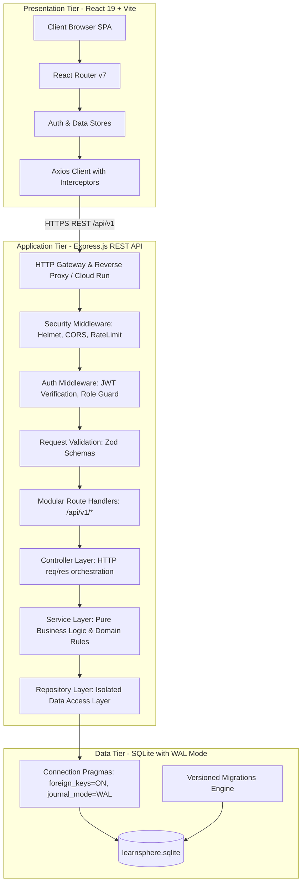

# LearnSphere System Architecture & Technical Specification

## 1. Executive Summary & Architectural Overview

**LearnSphere** is an enterprise-grade, modernized Learning Management System (LMS) built to replace an insecure, unmaintainable legacy monolith. It delivers a robust three-tier architecture ensuring strict relational data integrity, role-based access control (RBAC), end-to-end auditability, versioned database migrations, and production-ready observability.

---

## 2. Tiered System Architecture

### 2.1 Presentation Tier (Frontend)
- **Framework & Tooling**: React 19 bootstrapped with Vite, utilizing modern ES modules.
- **Routing**: `react-router-dom` with protected route wrappers (`RequireAuth`, `RequireRole`).
- **State & Data Fetching**: Centralized `AuthContext` with persistent session restoration; dedicated API client (`services/api.js`) featuring request/response interceptors, automatic bearer token injection, and unified 401/403/500 error interception.
- **Design System & Aesthetics**: Custom modular CSS design system implementing sleek dark/light modern themes, glassmorphism card surfaces, accessible ARIA labels, responsive flex/grid layouts, micro-animations, loading skeletons, and interactive state indicators.

### 2.2 Application Tier (Backend)
- **Runtime**: Node.js v22 LTS with native ES modules (`"type": "module"`).
- **Web Framework**: Express.js with a modular domain-driven package organization:
  - `modules/auth`: User registration, credential verification, JWT issuance, session self-query (`/me`).
  - `modules/courses`: Course catalog browsing, administrative authoring, status transitions (draft, published, archived), full-text search, and category filtering.
  - `modules/lessons`: Position-ordered lesson management, content delivery, adjacent navigation pointers (prev/next).
  - `modules/enrollments`: Atomic course enrollment, duplicate prevention, student enrollment history.
  - `modules/progress`: Deterministic progress computation, lesson completion tracking, cross-course safety enforcement.
  - `modules/admin`: Administrative metrics, user directory oversight, audit trail queries, and CSV report export.
  - `modules/health`: Liveness (`/health/live`) and readiness (`/health/ready`) probes verifying SQLite connectivity and filesystem status.
- **Layer Separation Protocol**:
  1. **Route Handlers**: Exclusively declare endpoint paths, HTTP verbs, and bind middleware pipelines.
  2. **Validators**: Validate query params, request bodies, and path variables using `zod`. Fail fast with HTTP 400 before business logic executes.
  3. **Controllers**: Parse validated input, invoke domain services, and format standardized JSON responses. Never execute SQL queries directly.
  4. **Services**: Contain pure business rules, transaction boundaries (`db.transaction()`), progress percentage algorithms, and domain event audit logging.
  5. **Repositories**: Encapsulate all SQL execution with prepared statements and parameter bindings. Exposes an interface ready for PostgreSQL substitution.

### 2.3 Data Tier (SQLite Database Engine)
- **Engine**: SQLite 3 with the high-performance native driver `better-sqlite3`.
- **Relational Integrity**:
  - `PRAGMA foreign_keys = ON;` strictly executed on every database connection initialization.
  - `PRAGMA journal_mode = WAL;` (Write-Ahead Logging) enabling concurrent readers without blocking writes.
  - `PRAGMA busy_timeout = 5000;` mitigating write lock contention by waiting up to 5,000ms before returning `SQLITE_BUSY`.
  - `PRAGMA synchronous = NORMAL;` optimizing disk I/O performance safely in WAL mode.
- **Migration Engine**: Custom, dependency-free, version-controlled migration runner recording executions in the `schema_migrations` audit table.

---

## 3. SQLite Concurrency & Locking Strategy

SQLite supports multiple concurrent readers alongside a single active writer. To ensure high availability and prevent concurrency deadlocks:

1. **Write-Ahead Logging (WAL)**: In WAL mode, reads read from the main database file and the WAL file without acquiring exclusive locks on writers, allowing readers and writers to operate concurrently.
2. **Short-Lived Transactions**: All multi-statement mutations (e.g., student enrollment + audit logging, lesson deletion + position re-indexing) are wrapped in immediate transactions (`BEGIN IMMEDIATE`) and kept under 10ms execution time.
3. **Connection Pooling Architecture**: SQLite is file-backed. A single shared database connection instance is managed as a singleton per Node process with synchronous query execution, preventing in-process file descriptor locks.
4. **Cloud Run Concurrency Notice**: In Google Cloud Run, instances must be configured with `max-instances: 1` if mounting a single network share (NFS/Cloud Storage FUSE), or preferably configured to transition to a managed Cloud SQL PostgreSQL database for horizontal scaling.

---

## 4. Progress Calculation Domain Rules

A core flaw of legacy systems is calculating progress from manually edited percentages or allowing students to record completions against lessons not belonging to their enrolled course.

LearnSphere enforces the following immutable domain rules:

1. **Single Source of Truth**: Progress percentage is **never** an editable column. It is dynamically computed or materialized via deterministic aggregation:
   $$\text{Progress \%} = \begin{cases} 0\% & \text{if } \text{TotalPublishedLessons} = 0 \\ \left\lfloor \frac{\text{CompletedLessonsCount}}{\text{TotalPublishedLessons}} \times 100 \right\rfloor & \text{if } \text{TotalPublishedLessons} > 0 \end{cases}$$
2. **Cross-Course Safety Enforcement**:
   - When marking a lesson complete for `enrollment_id = E` and `lesson_id = L`:
   - System asserts: `enrollments.course_id == lessons.course_id`.
   - If `course_id` does not match, the transaction aborts with HTTP 400 (`INVALID_CROSS_COURSE_PROGRESS`).
3. **Course Completion State**:
   - When $\text{Progress \%} == 100\%$, the enrollment status transitions atomically from `'active'` to `'completed'`.
   - If a course author subsequently publishes an additional lesson, the next progress evaluation dynamically downgrades completion status to `'active'`, maintaining relational truth.
