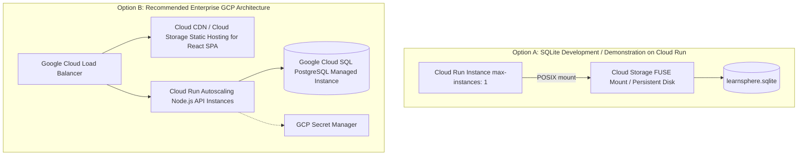

# Google Cloud Platform (GCP) Deployment Guide & Production Strategy

## 1. Architectural Reality: SQLite on Cloud Run

### 1.1 The Ephemeral Storage Constraint
Google Cloud Run instances are stateless, serverless containers. The container filesystem is written to memory/ephemeral local storage that is destroyed whenever an instance scales down to zero, crashes, or is restarted.

> [!CAUTION]
> Storing a production SQLite database directly inside a standard Cloud Run container filesystem will cause complete data loss when the instance restarts or scales.

### 1.2 The Multi-Instance Concurrency Limitation
Cloud Run is designed to scale horizontally across multiple container instances ($N > 1$). SQLite requires direct file-level POSIX locking:
- If multiple Cloud Run instances mount a shared network file volume (via Cloud Storage FUSE or Filestore NFS), network locking delays and lock lease drops can cause severe `SQLITE_BUSY` crashes or database corruption.
- SQLite is fundamentally a **single-writer** database engine.

---

## 2. Cloud Architecture Options for LearnSphere



### 2.1 Option A: SQLite on Cloud Run (Demo / Single-Instance Mode)
- **Configuration**:
  - `max-instances: 1` configured in `gcloud run deploy --max-instances=1`.
  - Use Cloud Storage FUSE volume mount or a single Compute Engine VM / Cloud Run Volume Mount for persistent storage.
  - Enable WAL mode and `PRAGMA busy_timeout = 5000;`.
- **Target Use Case**: Internal staging, evaluation, local developer emulation, zero-cost demonstration.

### 2.2 Option B: Enterprise Cloud SQL Modernization Path (Production Target)
- **Frontend**: Built static assets (`dist/`) hosted on Google Cloud Storage and distributed globally via Google Cloud CDN, or served via lightweight NGINX container.
- **Backend**: Containerized Express REST API deployed on Google Cloud Run with autoscaling enabled ($0 \rightarrow N$ instances).
- **Database**: Google Cloud SQL (PostgreSQL 16) with automated backups, point-in-time recovery, and connection pooling.
- **Data Access Layer Transition**: LearnSphere's repository layer (`backend/src/modules/*/repository.js`) strictly separates SQL execution from business services. Swapping `better-sqlite3` for `pg` / `knex` requires changing only the database connection pool and parameter placeholders (`?` $\rightarrow$ `$1, $2`).

---

## 3. Containerization Specification

### 3.1 Backend Container (`backend/Dockerfile`)
- Multi-stage build based on `node:22-alpine` for minimal attack surface.
- Native build tools installed for `better-sqlite3` compilation (`python3`, `make`, `g++`).
- Non-root user (`node`) execution for least-privilege security.
- Health check configured to query `GET /health/live`.

### 3.2 Frontend Container (`frontend/Dockerfile`)
- Multi-stage build: Stage 1 builds Vite bundle (`npm run build`); Stage 2 serves artifacts using lightweight `nginx:alpine` with gzip compression and cache headers.

### 3.3 Docker Compose (`docker-compose.yml`)
- Provides local orchestration mimicking cloud microservices with persistent volume mounts.

---

## 4. Production Environment Configuration

| Variable | Description | Production Guidance |
|---|---|---|
| `NODE_ENV` | Runtime mode | `production` |
| `PORT` | HTTP port | `8080` (Cloud Run default) |
| `DATABASE_PATH` | Path to SQLite file | `/app/data/learnsphere.sqlite` (set in the image) |
| `JWT_SECRET` | Token signing secret | **Required.** 32+ random characters from Secret Manager; startup fails if missing, short, or a value published in this repo |
| `ADMIN_EMAIL` / `ADMIN_PASSWORD` | First administrator | Created on startup only when no active admin exists; password from Secret Manager, 12+ chars |
| `LITESTREAM_BUCKET` | SQLite replica bucket | **Required on Cloud Run.** The entrypoint restores from and continuously replicates to this GCS bucket; run with `--max-instances 1` |
| `SEED_DEMO_DATA` | Demo accounts and enrollments | Leave unset (`false` in production). `true` only for a throwaway demo |
| `ALLOW_EPHEMERAL_DB` | Opt out of the Cloud Run storage check | Leave unset; `true` accepts losing all data on restart |
| `JWT_EXPIRES_IN` | Token duration | `1h` |
| `CORS_ORIGIN` | Allowed web origin | Fully qualified domain e.g. `https://learnsphere.example.com` |
| `RATE_LIMIT_WINDOW_MS` | Rate limit duration | `900000` (15 mins) |
| `RATE_LIMIT_MAX` | Max auth requests | `50` |

---

## 5. Post-Deployment Smoke Test Protocol

1. **Liveness Check**:
   ```bash
   curl -f https://<SERVICE_URL>/health/live
   # Expect: {"status":"UP","timestamp":"..."}
   ```
2. **Readiness Check**:
   ```bash
   curl -f https://<SERVICE_URL>/health/ready
   # Expect: {"status":"READY","database":"CONNECTED","migrations":"CURRENT"}
   ```
3. **Admin Verification**:
   Query `/api/v1/courses` and assert published courses load without errors.
