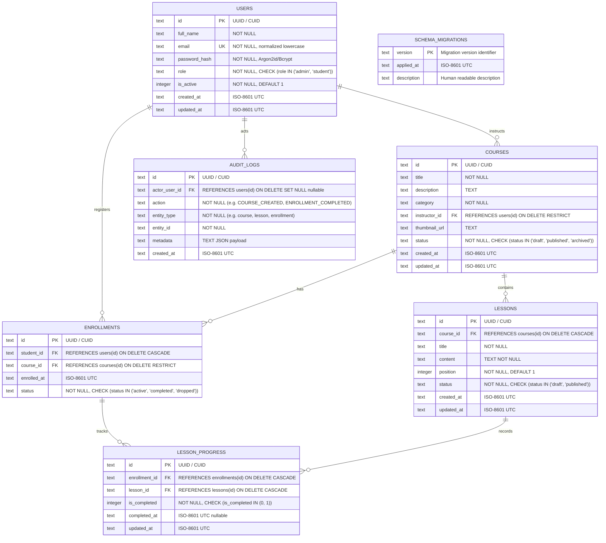

# LearnSphere Entity-Relationship Specification & Data Dictionary

## 1. Relational ER Diagram

---

## 2. Table Dictionaries & Constraint Details

### 2.1 `users`
| Column | Type | Nullable | Constraints & Defaults | Description |
|---|---|---|---|---|
| `id` | TEXT | NO | PRIMARY KEY | Unique user identifier (UUID v4) |
| `full_name` | TEXT | NO | `LENGTH(full_name) >= 2` | Display and legal name |
| `email` | TEXT | NO | UNIQUE, lowercase | Validated RFC 5322 email |
| `password_hash` | TEXT | NO | Hashed (Argon2id/Bcrypt) | Never stored in plaintext |
| `role` | TEXT | NO | `CHECK(role IN ('admin', 'student'))` | Role-based authorization |
| `is_active` | INTEGER | NO | `DEFAULT 1, CHECK(is_active IN (0, 1))` | Soft deactivation flag |
| `created_at` | TEXT | NO | ISO 8601 UTC | Account registration timestamp |
| `updated_at` | TEXT | NO | ISO 8601 UTC | Profile modification timestamp |

### 2.2 `courses`
| Column | Type | Nullable | Constraints & Defaults | Description |
|---|---|---|---|---|
| `id` | TEXT | NO | PRIMARY KEY | Unique course identifier |
| `title` | TEXT | NO | `LENGTH(title) >= 3` | Course title |
| `description` | TEXT | YES | `DEFAULT ''` | Markdown/HTML description |
| `category` | TEXT | NO | `NOT EMPTY` | Subject grouping |
| `instructor_id` | TEXT | NO | FK `users(id)` ON DELETE RESTRICT | Instructor reference |
| `thumbnail_url` | TEXT | YES | Sample/asset path | Thumbnail image reference |
| `status` | TEXT | NO | `CHECK(status IN ('draft', 'published', 'archived'))` | Course lifecycle state |
| `created_at` | TEXT | NO | ISO 8601 UTC | Creation timestamp |
| `updated_at` | TEXT | NO | ISO 8601 UTC | Last modified timestamp |

### 2.3 `lessons`
| Column | Type | Nullable | Constraints & Defaults | Description |
|---|---|---|---|---|
| `id` | TEXT | NO | PRIMARY KEY | Unique lesson identifier |
| `course_id` | TEXT | NO | FK `courses(id)` ON DELETE CASCADE | Parent course reference |
| `title` | TEXT | NO | `LENGTH(title) >= 1` | Lesson title |
| `content` | TEXT | NO | Body markdown/text | Structured lesson content |
| `position` | INTEGER | NO | `DEFAULT 1, CHECK(position >= 1)` | Sequence position within course |
| `status` | TEXT | NO | `CHECK(status IN ('draft', 'published'))` | Lesson publication state |
| `created_at` | TEXT | NO | ISO 8601 UTC | Creation timestamp |
| `updated_at` | TEXT | NO | ISO 8601 UTC | Last modified timestamp |

### 2.4 `enrollments`
| Column | Type | Nullable | Constraints & Defaults | Description |
|---|---|---|---|---|
| `id` | TEXT | NO | PRIMARY KEY | Unique enrollment identifier |
| `student_id` | TEXT | NO | FK `users(id)` ON DELETE CASCADE | Enrolled student reference |
| `course_id` | TEXT | NO | FK `courses(id)` ON DELETE RESTRICT | Enrolled course reference |
| `enrolled_at` | TEXT | NO | ISO 8601 UTC | Enrollment timestamp |
| `status` | TEXT | NO | `CHECK(status IN ('active', 'completed', 'dropped'))` | Enrollment lifecycle status |

*Uniqueness Constraint*: `UNIQUE(student_id, course_id)` prevents accidental or concurrent duplicate enrollments.

### 2.5 `lesson_progress`
| Column | Type | Nullable | Constraints & Defaults | Description |
|---|---|---|---|---|
| `id` | TEXT | NO | PRIMARY KEY | Unique progress identifier |
| `enrollment_id` | TEXT | NO | FK `enrollments(id)` ON DELETE CASCADE | Parent enrollment reference |
| `lesson_id` | TEXT | NO | FK `lessons(id)` ON DELETE CASCADE | Associated lesson reference |
| `is_completed` | INTEGER | NO | `CHECK(is_completed IN (0, 1))` | Boolean completion flag |
| `completed_at` | TEXT | YES | ISO 8601 UTC | Timestamp when completed |
| `updated_at` | TEXT | NO | ISO 8601 UTC | Last updated timestamp |

*Uniqueness Constraint*: `UNIQUE(enrollment_id, lesson_id)` guarantees idempotent progress updates.
*Cross-Course Integrity*: Before inserting or updating `lesson_progress`, the service layer verifies that `enrollments.course_id == lessons.course_id` inside an isolated transaction.

### 2.6 `schema_migrations`
| Column | Type | Nullable | Constraints | Description |
|---|---|---|---|---|
| `version` | TEXT | NO | PRIMARY KEY | SemVer or timestamp prefix (e.g., `001_initial_schema`) |
| `applied_at` | TEXT | NO | ISO 8601 UTC | Execution timestamp |
| `description` | TEXT | YES | Narrative | Brief summary of migration modifications |

### 2.7 `audit_logs`
| Column | Type | Nullable | Constraints | Description |
|---|---|---|---|---|
| `id` | TEXT | NO | PRIMARY KEY | Unique audit entry identifier |
| `actor_user_id` | TEXT | YES | FK `users(id)` ON DELETE SET NULL | User who initiated action |
| `action` | TEXT | NO | Uppercase action string | e.g. `USER_LOGIN`, `COURSE_CREATED` |
| `entity_type` | TEXT | NO | Resource class | e.g. `course`, `lesson`, `enrollment` |
| `entity_id` | TEXT | NO | Resource ID | Target entity identifier |
| `metadata` | TEXT | YES | JSON formatted string | Structured contextual payload |
| `created_at` | TEXT | NO | ISO 8601 UTC | Audit timestamp |

---

## 3. Database Indexing Strategy

To support fast queries and prevent full table scans as the dataset scales:

1. `idx_users_email`: `ON users(email)` — Fast authentication lookup.
2. `idx_courses_status`: `ON courses(status)` — Fast filtering for published public catalog.
3. `idx_courses_category`: `ON courses(category, status)` — Optimized category search.
4. `idx_lessons_course_position`: `ON lessons(course_id, position)` — Fast sequential syllabus rendering and prev/next resolution.
5. `idx_enrollments_student`: `ON enrollments(student_id, status)` — Fast student dashboard queries.
6. `idx_enrollments_course`: `ON enrollments(course_id)` — Rapid enrollment counts and instructor reporting.
7. `idx_progress_enrollment`: `ON lesson_progress(enrollment_id)` — High-speed calculation of completed lessons per enrollment.
8. `idx_audit_logs_created_at`: `ON audit_logs(created_at DESC)` — Chronological administrative audit log inspection.
