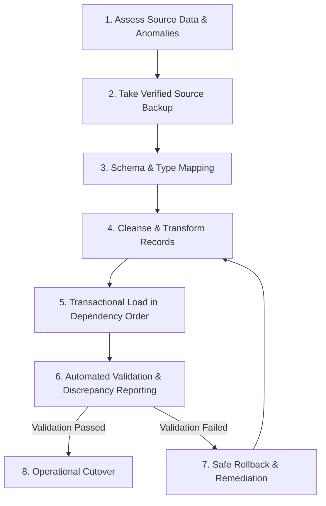

# Relational Database Migration Plan & Protocol

## 1. Migration Protocol Overview

This document outlines the rigorous, repeatable 8-step migration pipeline executed to transform legacy LMS database instances into the normalized, relational LearnSphere target database.

---

## 2. The 8-Step Migration Execution Protocol

### Step 1: Assess
1. Connect to the legacy database (`legacy-app/data/legacy.sqlite`).
2. Tally record counts across legacy tables: `legacy_users`, `legacy_courses`, `legacy_lessons`, `legacy_enrollments`, `legacy_progress`.
3. Audit data quality anomalies:
   - Untrimmed or uppercase email addresses (`" John.Doe@Domain.COM "`).
   - Non-standard timestamp formats (UNIX timestamps, US formatted strings `MM/DD/YYYY`).
   - Legacy status strings (`"active_course"`, `"in_review"`, `"published"`, `"finished"`).
   - Insecure password storage (MD5 hashes or unhashed plain text).
   - Orphaned records (progress rows referencing deleted enrollments or lessons).
   - Duplicate enrollments where `(user_id, course_id)` occurs multiple times.

### Step 2: Back up
1. Perform an online backup using SQLite's backup API or atomic copy while database locks are quiescent.
2. Verify backup checksum (`SHA-256`) and write timestamped backup file to `migration/backups/legacy_backup_<timestamp>.sqlite`.
3. Assert read integrity by issuing `PRAGMA integrity_check;` on the backup image.

### Step 3: Map
Formal mapping matrix between legacy and modernized schemas:

| Source Entity & Field | Target Entity & Field | Transformation & Cleansing Rule | Error/Rejection Strategy |
|---|---|---|---|
| `legacy_users.id` | `users.id` | Preserved or mapped to UUID string | Reject if null or empty |
| `legacy_users.name` | `users.full_name` | Trimmed whitespace, fallback to email handle if empty | Reject if `< 2` chars |
| `legacy_users.email` | `users.email` | Lowercased, trimmed, validated via RFC 5322 regex | Reject malformed; deduplicate |
| `legacy_users.password` | `users.password_hash` | If MD5 or plaintext, upgrade/rehash with Bcrypt or flag for reset | Never store legacy plaintext |
| `legacy_users.role` | `users.role` | Mapped: `'admin'` $\rightarrow$ `'admin'`, `'teacher'` $\rightarrow$ `'admin'`, all others $\rightarrow$ `'student'` | Default to `'student'` |
| `legacy_courses.id` | `courses.id` | Preserved or UUID mapped | Reject if null |
| `legacy_courses.title` | `courses.title` | Trimmed string | Reject if empty |
| `legacy_courses.category` | `courses.category` | Trimmed, capitalized | Fallback to `'General'` |
| `legacy_courses.status` | `courses.status` | `'active'`/`'published'` $\rightarrow$ `'published'`, `'archived'` $\rightarrow$ `'archived'`, else `'draft'` | Default `'draft'` |
| `legacy_lessons.id` | `lessons.id` | Preserved or UUID mapped | Reject if null |
| `legacy_lessons.course_id`| `lessons.course_id` | Foreign key to `courses.id` | Reject orphaned lessons |
| `legacy_lessons.order_idx`| `lessons.position` | Cast to integer `position >= 1` | Default to autoincrement sequence |
| `legacy_enrollments.id` | `enrollments.id` | Preserved or UUID mapped | Reject if null |
| `legacy_enrollments.user_id`| `enrollments.student_id` | Foreign key to `users.id` | Reject if user not found |
| `legacy_enrollments.course_id`| `enrollments.course_id` | Foreign key to `courses.id` | Reject if course not found |
| `(user_id, course_id)` | `enrollments` unique key | Deduplicate keeping earliest `enrolled_at` | Record duplicates in reject log |
| `legacy_progress.user_id` & `lesson_id` | `lesson_progress` | Map to target `enrollment_id` and `lesson_id` | Reject if lesson does not belong to course |

### Step 4: Transform
1. Cleanse and normalize each record in-memory.
2. Flag rejected records with explicit error categories (`INVALID_EMAIL`, `ORPHANED_FOREIGN_KEY`, `DUPLICATE_ENROLLMENT`, `CROSS_COURSE_MISMATCH`).
3. Store rejected records in a migration quarantine audit log without corrupting the target database.

### Step 5: Load
1. Open target database with `PRAGMA foreign_keys = ON;`.
2. Execute insertion in strict relational dependency order inside a single atomic transaction:
   - Phase 5.1: Insert `users`
   - Phase 5.2: Insert `courses`
   - Phase 5.3: Insert `lessons`
   - Phase 5.4: Insert `enrollments`
   - Phase 5.5: Insert `lesson_progress`
   - Phase 5.6: Insert migration execution into `schema_migrations`
3. Commit transaction. If any foreign key violation or constraint failure occurs, rollback immediately.

### Step 6: Validate
Run automated assertions against target database:
- Count parity: Target records = Source records - Rejected records.
- Foreign key check: `PRAGMA foreign_key_check;` returns 0 violations.
- Progress cross-course check: Every `lesson_progress` record belongs to a lesson whose `course_id` strictly matches the enrollment's `course_id`.
- Generate machine-readable JSON validation report (`migration/reports/migration_validation_report.json`) and formatted markdown summary.

### Step 7: Recover & Rollback
- If validation fails, the target database file is removed or restored from the pre-migration snapshot.
- The migration script is fully idempotent: re-executing it against an already migrated database will not duplicate records (using `INSERT OR IGNORE` or checking existing migration versions).

### Step 8: Cut over
- Once validation status is `'PASSED'` and foreign key check is clean, update connection configurations to point to modernized database.
- Archive legacy database file.
