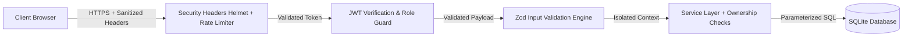

# LearnSphere Security & Threat Model

## 1. Security Architecture & Threat Model

LearnSphere incorporates defense-in-depth principles across the presentation, application, and data tiers, directly neutralizing common OWASP Top 10 vulnerabilities.



---

## 2. Authentication & Credential Management

### 2.1 Password Hashing
- **Algorithm**: Bcrypt with a work factor (salt rounds) of 12 or Argon2id (`memoryCost: 65536, timeCost: 3, parallelism: 4`).
- **Plaintext Policy**: Raw passwords exist only in ephemeral request memory during hashing/verification and are explicitly excluded from logs, error stack traces, and database serialization.
- **Complexity Requirement**: Minimum 8 characters, enforcing at least one uppercase letter, one lowercase letter, and one number.

### 2.2 Token-Based Authentication (JWT)
- **Algorithm**: HMAC SHA-256 (`HS256`) signed with a high-entropy secret (`JWT_SECRET`).
- **Claims**: Contains only non-sensitive identity metadata:
  ```json
  {
    "sub": "user_uuid_12345",
    "email": "student@learnsphere.io",
    "role": "student",
    "iat": 1718000000,
    "exp": 1718003600
  }
  ```
- **Expiration**: Short-lived (default 1 hour).
- **Transport**: Transmitted via HTTP `Authorization: Bearer <token>` or securely configured `HttpOnly`, `SameSite=Lax`, `Secure` cookies.

### 2.3 Secure Administrator Bootstrapping
- **No Public Privilege Escalation**: The registration endpoint (`POST /api/v1/auth/register`) strictly sets `role: 'student'`. Any attempt by a client to submit `"role": "admin"` in the payload is rejected by Zod validation.
- **Admin Provisioning Protocol**:
  Initial administrative accounts can only be provisioned through:
  1. A dedicated CLI seed script (`npm run seed:admin`) executed in an authenticated server shell with environment variables.
  2. Database bootstrap script during deployment initialization.

---

## 3. Authorization & Broken Access Control Defenses

### 3.1 Role Guard Middleware (`requireRole`)
- Endpoints categorized into:
  - **Public**: Course catalog browsing (`GET /api/v1/courses`), login, register, health checks.
  - **Authenticated (Any Role)**: Self profile (`GET /api/v1/auth/me`), student enrollment list (`GET /api/v1/me/enrollments`).
  - **Student Exclusive / Resource Owner**: Enrolling in courses, marking lesson progress for their own enrollment.
  - **Admin Exclusive**: Course authoring/editing/archiving, lesson creation/reordering, platform reports, user directory.

### 3.2 Resource Ownership & Cross-Tenant Defense
- **Progress Modification Defense**: When a student calls `PUT /api/v1/enrollments/:enrollmentId/lessons/:lessonId/progress`:
  1. The service looks up `enrollments.student_id`.
  2. It verifies that `enrollments.student_id === req.user.id`. If mismatched, it immediately throws HTTP 403 (`FORBIDDEN_RESOURCE_ACCESS`).
  3. It verifies that `lessons.course_id === enrollments.course_id`. If mismatched, it throws HTTP 400 (`CROSS_COURSE_PROGRESS_FORGERY`).

---

## 4. Input Validation & Injection Mitigation

### 4.1 SQL Injection Prevention
- All repository queries use strict parameterized prepared statements via `better-sqlite3`:
  ```javascript
  // Compliant: Parameterized statement
  const stmt = db.prepare('SELECT * FROM users WHERE email = ?');
  const user = stmt.get(normalizedEmail);
  ```
- String concatenation or template literals in SQL strings are strictly prohibited and flagged by ESLint rules.

### 4.2 Request Body Sanitization with Zod
- Every incoming endpoint payload is schema-validated before controller dispatch.
- Unknown fields are stripped (`strip()` or strict parsing), preventing prototype pollution and mass assignment attacks.

---

## 5. Network Security & Operational Hardening

### 5.1 Security Headers (Helmet)
- Content-Security-Policy (CSP) headers enabled.
- `X-Frame-Options: DENY` preventing clickjacking.
- `X-Content-Type-Options: nosniff` preventing MIME confusion attacks.
- Strict-Transport-Security (HSTS) enforced on HTTPS connections.

### 5.2 Rate Limiting
- Public authentication routes (`/api/v1/auth/login`, `/api/v1/auth/register`) restricted via `express-rate-limit` (e.g., maximum 10 requests per 15-minute window per IP) to prevent automated brute-force credential stuffing.

### 5.3 Audit Logging
- Security-critical events (`USER_REGISTERED`, `USER_LOGIN_SUCCESS`, `USER_LOGIN_FAILED`, `COURSE_CREATED`, `ENROLLMENT_CREATED`, `PROGRESS_UPDATED`) are written to the `audit_logs` table with actor ID, target entity, timestamp, and metadata.
