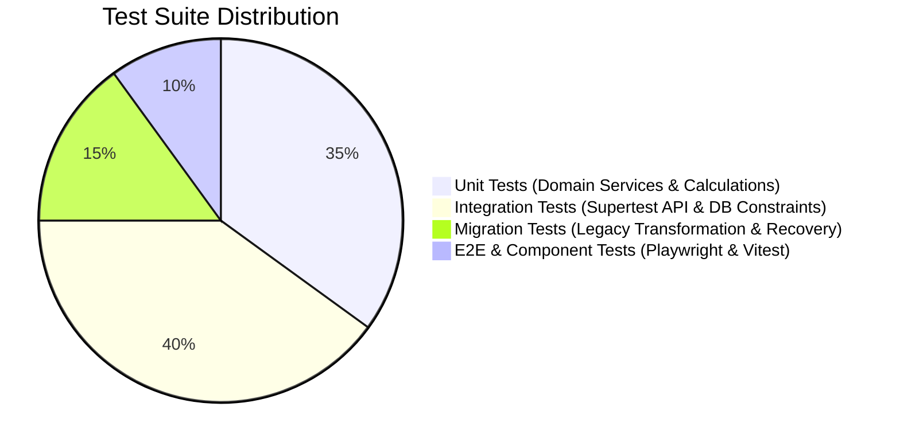

# LearnSphere Testing Strategy & Quality Assurance Framework

## 1. Quality Assurance Philosophy & Testing Pyramid

LearnSphere uses a multi-layered testing pyramid to guarantee reliability across unit logic, database transactions, API contracts, migration pipelines, and end-to-end browser workflows.

---

## 2. Test Execution Layers

### 2.1 Layer 1: Unit Tests (Vitest)
- **Scope**: Pure business logic in service files (`progressService`, `courseService`, `authService`).
- **Isolation**: In-memory data structures or mocked repository interfaces.
- **Key Scenarios Tested**:
  - Deterministic progress calculation with 0 published lessons $\rightarrow$ returns 0%.
  - Deterministic progress calculation with partial completions.
  - Rounding behavior and 100% completion trigger.
  - Normalization helpers (email casing, timestamp conversions).

### 2.2 Layer 2: API Integration Tests (Supertest + SQLite In-Memory)
- **Scope**: Full HTTP request-response lifecycle with live Express middleware, Zod validators, controllers, and SQLite database with foreign keys enabled.
- **Environment**: Each test suite runs against an isolated SQLite test database initialized with versioned migrations, cleaned up between runs.
- **Core Coverage**:
  - Valid and invalid login/registration flows.
  - JWT generation, expiration, and tampering detection.
  - Role-based authorization rejection (HTTP 403 when student calls admin endpoints).
  - Transaction rollbacks on simulated database errors.

### 2.3 Layer 3: Database Integrity & Constraint Tests
- **Scope**: Verification of foreign-key cascading, unique constraints, and transaction atomicity.
- **Key Scenarios Tested**:
  - Inserting enrollment with non-existent student or course fails with `SQLITE_CONSTRAINT_FOREIGNKEY`.
  - Duplicate enrollment `(student_id, course_id)` fails with `SQLITE_CONSTRAINT_UNIQUE`.
  - Cross-course progress validation rejects mismatched lesson IDs.

### 2.4 Layer 4: Migration Pipeline & Recovery Tests
- **Scope**: Full execution of the 8-step migration protocol using synthetic legacy fixture databases.
- **Key Scenarios Tested**:
  - Identification and quarantine of dirty emails and missing timestamps.
  - Preservation of valid user, course, lesson, and enrollment relationships.
  - Idempotence: Re-running the migration script against an already migrated database results in zero duplicate records and zero errors.
  - Rollback on failure: Injected corrupted records trigger a safe transactional abort, leaving target database consistent.

### 2.5 Layer 5: End-to-End (E2E) Browser Tests (Playwright)
- **Scope**: User journey simulations running against the built React frontend and Express backend.
- **Key Scenarios Tested**:
  - Student registration $\rightarrow$ login $\rightarrow$ course catalog browsing $\rightarrow$ enrollment $\rightarrow$ lesson viewing $\rightarrow$ mark as complete $\rightarrow$ verify progress bar updates to 100%.
  - Admin login $\rightarrow$ create course $\rightarrow$ add lessons $\rightarrow$ publish course $\rightarrow$ verify catalog update.

---

## 3. Required Scenarios Verification Matrix

| # | Test Scenario | Test Type | File Location | Validation Criteria |
|---|---|---|---|---|
| 1 | Student registration and login | Integration | `backend/tests/auth.test.js` | Returns HTTP 201/200, JWT token, user object sans password hash |
| 2 | Admin-only course creation | Integration | `backend/tests/courses.test.js` | HTTP 201 for admin; HTTP 403 for student or unauthenticated |
| 3 | Student enrollment in published course | Integration | `backend/tests/enrollments.test.js` | HTTP 201, creates active enrollment record |
| 4 | Repeated enrollment prevents duplicates | DB & API | `backend/tests/enrollments.test.js` | HTTP 409 or handled duplicate; exactly 1 record in DB |
| 5 | Student cannot modify another's progress | Security | `backend/tests/progress.test.js` | HTTP 403 Forbidden when student ID mismatches enrollment owner |
| 6 | Lesson cannot be completed in unrelated course | DB & API | `backend/tests/progress.test.js` | HTTP 400 Bad Request; cross-course transaction aborted |
| 7 | Course progress calculation correctness | Unit & API | `backend/tests/progress.test.js` | Accurately calculates $0\%, 50\%, 100\%$; handles 0 lessons |
| 8 | Invalid records detected in migration | Migration | `migration/tests/migration.test.js` | Dirty emails flagged, invalid statuses quarantined |
| 9 | Migration preserves valid relationships | Migration | `migration/tests/migration.test.js` | Foreign keys intact; `PRAGMA foreign_key_check` returns 0 |
| 10 | Migration re-run idempotence | Migration | `migration/tests/migration.test.js` | Second run exits cleanly with 0 duplicates inserted |
| 11 | Failed migration recovery & rollback | Migration | `migration/tests/migration.test.js` | Injected schema error cleanly rolls back; DB state uncorrupted |
| 12 | Reports match underlying DB data | Integration | `backend/tests/reports.test.js` | Aggregation queries in CSV match relational row counts |
